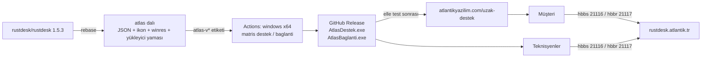

# Atlas (RustDesk tabanlı) — Tasarım

Tarih: 2026-11-26 · Durum: onay bekliyor (gözden geçirildi, sorular cevaplandı)

## Teşhis ve neden

- Kendi uzak masaüstü yazılımımız (Atlas, `D:\HERD\atlas-legacy`, C++/WebRTC) hareketli görüntüde
  donma ve kopma yaşadı; RustDesk performansına yaklaşamadı. Bırakıldı, arşivde kalır.
- Kendi RustDesk sunucumuz çalışıyor (`rustdesk.atlantik.tr`, anahtar zorunlu). Müşteriye bugün
  resmi imzalı exe, dosya adına gömülü ayarla (`rustdesk-host=…,key=…,relay=…,.exe`) dağıtılıyor.
- Eksik olan: **kendi logomuz** ve **exe'nin içine gömülü, değiştirilemez ayarlar**. Resmi
  istemcide bunlar yalnızca Pro'nun "custom client generator"ı ile geliyor. Kullanıcının bilgisi:
  "açık kaynak istemci özelleştirilemiyor".
- Gerçek: Pro'nun yöntemi, exe yanına konan ve RustDesk Ltd anahtarıyla **imzalı** `custom.txt`
  (`src/common.rs` → `load_custom_client` / `read_custom_client`). İçerik: `app-name`,
  `default-settings`, `override-settings`, geri kalan anahtarlar → `HARD_SETTINGS`. Açık kaynak
  kodu fork'layıp aynı yapıları imza olmadan, derleme anında doldurabiliriz. AGPL-3.0 buna izin
  verir; şartı, değiştirilmiş kaynağın exe'yi alanlara sunulmasıdır.

## Hedefler

1. İki ayrı Windows exe, aynı fork'tan:
   - **Atlas Destek** (müşteri): yalnızca bağlantı **alır**. Ekranda logo, ID, tek kullanımlık
     şifre, "Hazır" durumu. Ayarlar, adres defteri, hesap, kurulum kapalı.
   - **Atlas Bağlantı** (teknisyen): yalnızca bağlantı **yapar**. Ayarlar kilitli. Pano ve dosya
     aktarımı açık.
2. Sunucu (`rustdesk.atlantik.tr`), relay (aynı) ve anahtar
   (`ITPXTrZ5mbvvLRzWnGfW9KcYWgJrXKnL0eQd9TO9g0w=`) exe içinde; kullanıcı değiştiremez, dosya adına
   bağlı değil.
3. Logo: atlantik-crm `public/images/app-icon-512.png` (512×512, beyaz zemin). Uygulama ikonu,
   pencere/ana ekran logosu, tepsi ikonu, exe ikonu bundan üretilir.
4. Bağlantı kalitesi resmi RustDesk 1.5.3 ile aynı: görüntü motoruna, kodeklere, taşıma katmanına
   dokunulmaz.
5. Derleme GitHub Actions'ta; geliştirici bilgisayarına Rust/Flutter kurulmaz.

## Hedef olmayanlar (bu proje)

- Mac, Linux, Android derlemeleri (sonraki dilim).
- Authenticode imzası — ilk sürüm imzasız, SmartScreen uyarısı kabul edildi. Sertifika ayrı karar.
- Adres defteri / API sunucusu / panel (`2026-11-26-rustdesk-panel-design.md`, beklemede).
  Teknisyen exe'sinde adres defteri ve hesap şimdilik kapalı.
- Gözetimsiz erişim, Windows servisi, kalıcı kurulum. İki exe de taşınabilir (portable) çalışır.
- Kendi otomatik güncelleme kanalımız.
- RustDesk arayüzünü yeniden tasarlamak; yalnızca marka ve kilitler.

## Anti-hedefler (çalışsa bile başarısızlık sayılır)

- Exe'nin resmi RustDesk sunucularına (`rs-ny.rustdesk.com` vb.) bağlanması ya da kendini resmi
  RustDesk sürümüne güncellemesi.
- Müşteri exe'sinden dışarıya bağlantı yapılabilmesi veya ayarların açılabilmesi.
- Upstream'den sapmanın büyümesi: değişiklik az sayıda dosyada, her RustDesk sürümüne
  yarım günde taşınabilir kalmalı. Görüntü/taşıma koduna yama yok.
- AGPL ihlali: kaynak gizli, telif bildirimleri silinmiş, ya da "RustDesk" markası bizim ürün adı
  gibi kullanılmış.
- İki exe'nin aynı bilgisayarda (veya resmi RustDesk ile) ayar/servis çakışması.

## Kısıtlar

- Upstream: `rustdesk/rustdesk` 1.5.3 etiketi (sunucu 1.1.16 ile çalıştığı doğrulandı). Alt
  modül `libs/hbb_common` fork'lanmaz.
- Sunucu tarafı değişmez (hbbs/hbbr `-k _` ile anahtar zorunlu).
- Kod yorumları ve commit mesajları İngilizce (fork herkese açık, upstream ile uyum). Kullanıcıya
  görünen yeni metinler Türkçe.

## Yaklaşımlar

| | Ne | Bedel | Karar |
|---|---|---|---|
| **A** | RustDesk'i fork'la, ayar/logo/adı derlemeye göm, kendi Actions işimizle derle | İmzasız exe (SmartScreen); her upstream sürümünde küçük yamaları taşımak | **Seçildi** |
| B | Bugünkü gibi resmi imzalı exe + dosya adı hilesi | Logo yok, Ayarlar ekranı boş görünür, Mac/Linux'ta ayar metni yapıştırma | Reddedildi: istenen iki şeyi vermiyor |
| C | RustDesk Pro lisansı | Yıllık ücret | Reddedildi |
| — | Atlas'ı RustDesk sunucusuna bağlamak | Atlas WebRTC, hbbr düz TCP; taşıma yeniden yazılır ve asıl sorun (görüntü kalitesi) çözülmez | Elendi |

İki exe mi tek exe mi: kullanıcı **iki exe** seçti.

## Kararlar

### Kullanıcının kararları
- Yaklaşım A; iki exe (müşteri yalnızca gelen, teknisyen yalnızca giden).
- Logo: atlantik-crm'deki küçük kenar çubuğu logosu.
- **Ürün adı: Atlas.** Bırakılan C++ projesinin adı bu ürüne geçer (eski depo `atlas-legacy`
  olarak arşivde kalır). Varyant adları "Atlas Destek" / "Atlas Bağlantı" tasarımcının kararı.
- **Yetki:** Atlas Destek normal kullanıcı olarak açılır, açılışta UAC sorulmaz. Teknisyen
  gerektiğinde oturum içinden yetki yükseltmeyi ister, müşteri UAC'ta bir kez "Evet" der
  (upstream'in taşınabilir sürümdeki mevcut davranışı). Builder, `disable-installation=Y`'nin bu
  yolu (taşınabilir servis / elevation) kapatmadığını doğrular; kapatıyorsa kurulum düğmesini
  başka yoldan gizler, yükseltmeyi korur.
- **Bağlantı onayı (destek):** şifre **ya da** tıklayarak kabul, ikisi de geçerli
  (`approve-mode` = şifre+tık). Yalnızca tek kullanımlık şifre (`verification-method` = geçici
  şifre); kalıcı şifre tanımlanamaz. Şifre her oturumdan sonra yenilenir. Hepsi `override-settings`
  / `HARD_SETTINGS` ile gömülür, müşteri değiştiremez. Builder anahtar adlarını 1.5.3 kaynağından
  doğrular; "her oturumdan sonra yenile" için hazır ayar yoksa oturum kapanışında geçici şifreyi
  yenileyen en küçük yama yapılır.

### Tasarımcının kararları (itiraz edilebilir)
- **Fork:** GitHub `fatihgormus81/atlas-rustdesk` (upstream'den fork, herkese açık). Herkese
  açık olması AGPL'in "kaynağı sun" şartını kendiliğinden karşılar. Yerel klon:
  `D:\HERD\atlas-rustdesk`. Bu doküman fork oluşunca oraya `docs/atlas/` altına taşınır;
  iç ağ adresleri gibi gizli bilgi içermez (anahtar zaten herkese açık, sitede yayında).
- **Dal düzeni:** `atlas` dalı = `1.5.3` etiketi + bizim commit'lerimiz. Yeni sürümde yeni
  etikete rebase. `master` upstream'i takip eder, dokunulmaz.
- **Uygulama adları ve dosyalar:**

  | Varyant | `app-name` | Exe | `conn-type` |
  |---|---|---|---|
  | destek | `Atlas Destek` | `AtlasDestek.exe` | `incoming` |
  | baglanti | `Atlas Bağlantı` | `AtlasBaglanti.exe` | `outgoing` |

  Ad farklı olduğu için ayar klasörü, IPC adı ve servis adı RustDesk'ten ve birbirinden ayrışır
  (`APP_NAME` bunları türetir). `is_custom_client()` (`app-name != "RustDesk"`) da devreye girer.
  Builder, `Bağlantı`'daki Türkçe karakterin klasör/IPC/pipe adında sorun çıkarıp çıkarmadığını
  doğrular; çıkarırsa iç ad `AtlasBaglanti`, görünen ad `Atlas Bağlantı` olur.
- **Gömme yöntemi:** Varyant derleme anında seçilir (ör. ortam değişkeni
  `ATLAS_VARIANT=destek|baglanti` → `build.rs` ya da Cargo feature). Seçilen varyantın JSON'u
  (`res/atlas/destek.json`, `res/atlas/baglanti.json`) `include_str!` ile gömülür ve
  `load_custom_client()` başında, `read_custom_client` ile aynı ayrıştırmadan **imza doğrulaması
  olmadan** geçirilir. Mevcut imzalı `custom.txt` yolu silinmez ama bizim derlemede gömülü ayar
  öncelikli olur (exe yanına konan bir `custom.txt` gömülü ayarı ezemez).
- **Sunucu ayarları:** `hbb_common` sabitleri (`RENDEZVOUS_SERVERS`, `RS_PUB_KEY`) yerine
  `override-settings` içinde `custom-rendezvous-server`, `relay-server`, `key` verilir;
  `api-server` boş. Böylece alt modül fork'lanmaz.
- **Kilitler (`HARD_SETTINGS` / built-in):**

  | Ayar | destek | baglanti |
  |---|---|---|
  | `conn-type` | `incoming` | `outgoing` |
  | `disable-settings` | `Y` | `Y` |
  | `disable-ab` | `Y` | `Y` |
  | `disable-account` | `Y` | `Y` |
  | `disable-installation` | `Y` | `Y` |
  | pano / dosya aktarımı | açık (varsayılan) | açık (varsayılan) |

  Pano ve dosya aktarımı müşteri tarafında da açık olmalı (izin bağlantı alan uçta verilir).
- **Otomatik güncelleme:** Her iki varyantta güncelleme denetimi kapalı. Builder,
  `is_custom_client()` ile zaten kapanıp kapanmadığını kaynakta doğrular; kapanmıyorsa açıkça
  kapatır (anti-hedef).
- **Marka:** Exe meta verisi (`[package.metadata.winres]`): `ProductName` varyant adı,
  `FileDescription` "Atlas Destek — RustDesk tabanlı uzak destek", `LegalCopyright`
  "© 2026 Atlantik Yazılım · RustDesk tabanlıdır (AGPL-3.0)". Kaynak dosyalardaki RustDesk telif
  bildirimleri ve `LICENCE` korunur. Ana ekran, pencere başlığı, tepsi menüsü ve bağlantı izin
  penceresinde görünen "RustDesk" yazıları varyant adına döner (`get_app_name()` kullanılan
  yerler zaten döner; sabit metinler taranır).
- **Kaynak kod bağlantısı (AGPL):** "Hakkında" Ayarlar'ın içinde ve Ayarlar kapalı olduğundan
  orada gösterilmez. Bağlantı exe'nin indirildiği yerlerde durur: `/uzak-destek` sayfasında
  indirme düğmesinin yanında ve GitHub Release sayfasında. Arayüze yama yapılmaz.
- **Doğrulanmış (1.5.3 kaynağı):** `check_software_update()` `is_custom_client()` iken erken
  döner; arka plan güncellemesi yalnızca `allow-auto-update` ile çalışır. `load_custom_client()`
  `core_main` başında çalışır, gömülü ayar her okumadan önce uygulanır.
- **İkonlar:** `app-icon-512.png`'den üretilen `.ico`/`.png` setleri repoya **commit edilir**
  (derleme anında üretim yok). Beyaz zemin ilk sürümde kabul; şeffaf sürüm ileride değiştirilebilir.
- **Paket biçimi:** Her varyant tek dosya, kurulumsuz çalışan exe (upstream'in Windows
  "portable packer" çıktısıyla aynı biçim). MSI yok.
- **Derleme işi:** Upstream `flutter-build.yml`'in `build-for-windows-flutter` işinden türetilen,
  yalnızca Windows x64 ve imzalamasız, iki varyantı matris olarak derleyen
  `.github/workflows/atlas-windows.yml`. Tetikleyici: elle (`workflow_dispatch`) ve
  `atlas-v*` etiketleri. Çıktı: GitHub Release'e iki exe + SHA256. Upstream iş dosyaları
  silinmez (fork'ta kendiliğinden çalışmamaları için devre dışı bırakılabilir).
- **Sürüm adı:** `1.5.3-atlas.1` biçimi (upstream sürümü + bizim sayaç).
- **Dağıtım:** atlantik-website `/uzak-destek` Windows indirmesi `AtlasDestek.exe`'yi verir
  (`RemoteSupportController::DOWNLOAD_NAME` değişir, testi güncellenir); sayfaya kaynak kod
  bağlantısı eklenir. Mac/Linux indirmeleri bu projede eski hâliyle kalır. Teknisyen exe'si
  sitede yayınlanmaz; teknisyenlere GitHub Release'ten verilir. Site değişikliği ayrı dilim,
  exe'ler elle test edildikten sonra.

## Akış

## Dilimler

1. **Fork + derleme hattı:** fork, `atlas` dalı, sadeleştirilmiş Windows işi upstream'i
   değiştirmeden derleyip imzasız exe üretir. (Hattın kendisi doğrulanır.)
2. **Gömülü ayar + varyant:** JSON'lar, yükleyici yaması, iki varyant derlenir; sunucuya bağlanır,
   kilitler etkin.
3. **Marka:** ikonlar, ad, winres, görünür metinler, Hakkında'da kaynak bağlantısı.
4. **Site:** `/uzak-destek` yeni exe'yi verir (atlantik-website, Pest testiyle).

## Test

- **Otomatik (Actions'ta, her derlemede):** Rust birim testi — her varyant JSON'u ayrışır;
  `APP_NAME`, `conn-type`, `custom-rendezvous-server`, `key`, `disable-*`, `approve-mode`,
  `verification-method` beklenen değerde;
  gömülü ayar varken exe yanındaki `custom.txt` bunları ezemez. Upstream'in mevcut testleri
  kırılmaz.
- **Elle kabul (temiz Windows 10 ve 11 makinede, her sürümde):**
  1. `AtlasDestek.exe` açılır → logo, ID, şifre, "Hazır"; Ayarlar ve bağlan kutusu yok.
  2. `AtlasBaglanti.exe` ile bağlanılır → görüntü, klavye/fare.
  3. Pano iki yönde (metin), dosya aktarımı iki yönde.
  3a. Bağlantı hem şifreyle hem tıklayarak kabul edilebilir; oturum bitince şifre değişmiş olur;
      kalıcı şifre tanımlama yolu yok.
  3b. Teknisyen oturumda yetki yükseltir → müşteri UAC'ı onaylar → teknisyen bir UAC penceresini
      görür ve tıklar.
  4. Relay zorlanarak (P2P'nin kurulamadığı ağ ya da `force-always-relay`) aynı testler.
  5. Hareketli görüntü (tam ekran video, 2 dk) — resmi RustDesk 1.5.3 ile aynı ağda gözle
     karşılaştırma; belirgin fark olmamalı.
  6. Resmi RustDesk ve iki exe aynı makinede birlikte açıkken çakışma yok.
  7. Ağ izlemede `*.rustdesk.com`'a bağlantı yok (güncelleme denetimi dahil).
  8. Anahtarsız resmi istemci sunucuya hâlâ bağlanamaz (sunucu değişmedi, regresyon kontrolü).

## Builder'a bırakılanlar

- Yükleyici yamasının tam yeri ve biçimi (`build.rs` + `include_str!` ya da Cargo feature).
- Upstream iş dosyasından hangi adımların gerektiği; vcpkg/Flutter önbelleği.
- İkon setinin boyutları ve hangi dosyalara yazılacağı (upstream'deki mevcut ikon yolları).
- Görünür "RustDesk" metinlerinin taranması ve hangilerinin değişeceği (ana akış ekranları
  öncelikli; çeviri dosyalarının tamamı değil).

## Bilinçli olarak kapsam dışı

- Mac/Linux/Android, Authenticode, MSI, servis/gözetimsiz erişim, kendi güncelleme kanalı,
  adres defteri ve panel, arayüz yeniden tasarımı. Her biri ayrı karar ve ayrı dilimdir.
